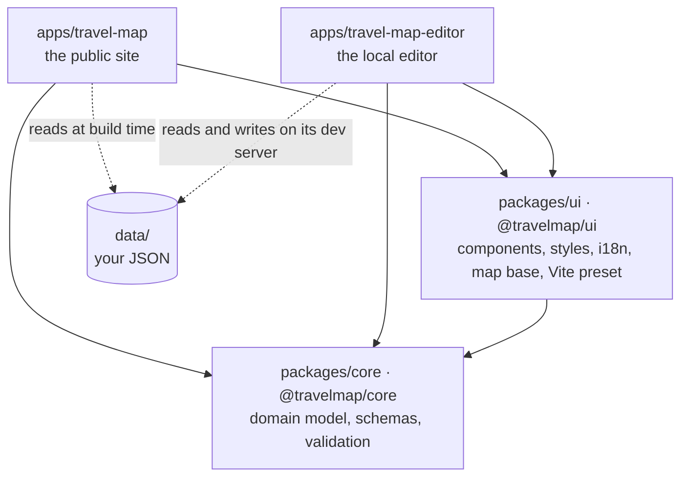

# Architecture

Travel Map is a pnpm workspace of two apps and two packages. This page is the
map of where things live and which way the dependencies run; the rules for
writing the code itself are in [CODING_GUIDELINES.md](./CODING_GUIDELINES.md).

## The four projects



- **`@travelmap/core`** is plain TypeScript with no React: the classes
  (`Trip`, `City`, `Country`…), the Zod schemas for every authored document,
  `buildWorld` (the one place raw JSON becomes a linked graph), dates,
  distances, ids, and the validation the editor shows its author.
- **`@travelmap/ui`** is everything both apps render or configure the same
  way: `NavRail`, `Button`, `Dialog`, `PanelFrame`, `PanelHeader`, `Popover`
  and the other shared components; the design tokens and mixins; i18next with
  its `common` namespace; the map base (`BaseMap`, `WorldLayers`,
  `RouteLines`); the flags and map glyphs; and the Vite preset both apps start
  from.
- **The site** builds the dataset into a static bundle and shows it.
- **The editor** reads and writes the dataset through its local dev server.

Neither package imports an app, and neither app imports the other.

## Where a module goes

| It is…                                              | It goes in                      |
| --------------------------------------------------- | ------------------------------- |
| Logic about trips, places, dates or the JSON shapes | `packages/core`                 |
| React, DOM, styles, translations or the map, shared | `packages/ui`                   |
| Used by one app only                                | that app                        |
| Used by one feature only                            | that feature                    |
| Used by two features of one app                     | that app's `shared/` or `data/` |

## Inside each app

Both apps have the same four layers, and lint enforces the direction:

```text
app/        routes and the shell        → may use features, shared, data
features/   one capability each         → may use shared, data; never another feature
shared/     what several features use   → may use data
data/       the dataset                 → only static JSON and @travelmap/core
```

| Layer       | Site                                                     | Editor                                           |
| ----------- | -------------------------------------------------------- | ------------------------------------------------ |
| `app/`      | `router.tsx`, `MapShell`                                 | `EditorRoutes`, `EditorShell`                    |
| `features/` | trips, places, gallery, timeline, stats, map, navigation | trips, places, companies, settings, map, palette |
| `shared/`   | contexts, hooks, bottom sheet, year pills                | fields, combobox, date picker, add-place dialog  |
| `data/`     | `world.ts` builds the graph once                         | `store.ts` holds and writes the documents        |

Both keep one map mounted behind a panel. The site's routes decide which panel
shows over its map; the editor's screens each describe what its map draws.

## Shared configuration

- `tsconfig.base.json` holds the compiler options every project extends.
- `packages/ui/vite/preset.ts` gives both apps React with React Compiler,
  SVGR, the Sass load path for the shared tokens, the `@/` alias for the app's
  own `src`, and the shared public files.
- `eslint.config.mjs` at the root lints every project with the same rules,
  including the layer boundaries above.
- `pnpm check` runs typecheck, lint, formatting, tests, knip, React Doctor and
  the audit across all four projects.
